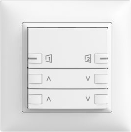

# Feller zeptrionAir for Home Assistant

Custom integration for **Feller zeptrionAir** Wi-Fi switches (zApp 3340-2-x and 3340-4-x). Fully local and push-based: wall-switch presses show up in Home Assistant within a fraction of a second, with no cloud and no account. Built on the [zeptrionair-api](https://github.com/diaznet/zeptrionair-api) library.

  

<h2 align="center">
  📖 <a href="https://github.com/diaznet/ha-zeptrionair/wiki">Documentation: the Wiki</a>
</h2>

  <a href="https://github.com/diaznet/ha-zeptrionair/wiki">English</a> ·
  <a href="https://github.com/diaznet/ha-zeptrionair/wiki/de-Startseite">Deutsch</a> ·
  <a href="https://github.com/diaznet/ha-zeptrionair/wiki/fr-Accueil">Français</a> ·
  <a href="https://github.com/diaznet/ha-zeptrionair/wiki/it-Home">Italiano</a>

## Quick install

Requires Home Assistant **2025.2** or newer.

1. Open **Settings → Marketplace** (Home Assistant 2026.11 and newer) or **HACS**, search for **Feller zeptrionAir** and download it.
2. Restart Home Assistant.
3. Your zApps appear under **Settings → Devices & services** as discovered. Click **Add**. Or add one by hand: **Add integration → Feller zeptrionAir**, then enter its hostname or IP address.
4. For covers: press **Calibrate** once on each cover to get positions.

Manual installation, updating and the details are in the wiki: [Installation](https://github.com/diaznet/ha-zeptrionair/wiki/Installation) · [Setup](https://github.com/diaznet/ha-zeptrionair/wiki/Setup).

## What it does

| | |
|---|---|
| **Lights** | On/off channels and dimmers (experimental). [More](https://github.com/diaznet/ha-zeptrionair/wiki/Lights-and-dimmers) |
| **Covers** | Blinds, shades and awnings with live state. Open/closed is detected from the end stops, and positions come from travel times that are measured for you. [More](https://github.com/diaznet/ha-zeptrionair/wiki/Covers) |
| **Slats** | Tilt controls for blinds. [More](https://github.com/diaznet/ha-zeptrionair/wiki/Slats) |
| **Scenes** | Recall and store the 4 scenes kept on each channel. Recalls made at the wall are followed. [More](https://github.com/diaznet/ha-zeptrionair/wiki/Scenes) |
| **Keys and LEDs** | An event per Smartfront key and Smartbutton for automations; Smartfront LEDs as status lights. [More](https://github.com/diaznet/ha-zeptrionair/wiki/Keys-events-and-LEDs) |
| **Smartbuttons** | Program them from Home Assistant; they then work without it. [More](https://github.com/diaznet/ha-zeptrionair/wiki/Smartbuttons) |
| **Actions** | Scenes, steps, calibration, names, Smartbuttons. [More](https://github.com/diaznet/ha-zeptrionair/wiki/Actions) |
| **Diagnostics** | Wi-Fi signal, temperature and connection sensors, *Reconnect*, a redacted diagnostics download. [More](https://github.com/diaznet/ha-zeptrionair/wiki/Troubleshooting) |
| **Languages** | English, Deutsch, Français, Italiano |

Tested on 3340-2-B with firmware 01.08.28 (on/off lights, blinds and shades, Smartfront). Other models, dimmers, awnings and sensor fronts are expected to work but are untested: please [open an issue](https://github.com/diaznet/ha-zeptrionair/issues) with a diagnostics download. See [Supported hardware](https://github.com/diaznet/ha-zeptrionair/wiki#supported-hardware).

## Help

[Troubleshooting](https://github.com/diaznet/ha-zeptrionair/wiki/Troubleshooting) · [FAQ](https://github.com/diaznet/ha-zeptrionair/wiki/FAQ) · [Issues](https://github.com/diaznet/ha-zeptrionair/issues) · [Changelog](CHANGELOG.md)

## Development

Tests run against a simulated device: `pytest --cov` with `requirements_test.txt` (Linux, Python 3.14). Contributor notes, including AI coding agents: [AGENTS.md](AGENTS.md).

## Disclaimer

Not affiliated with or endorsed by Feller AG or the Open Home Foundation. "zeptrion" and "zeptrionAIR" are trademarks of Feller AG. Thanks to [heldchen/ha-zeptrion-air](https://github.com/heldchen/ha-zeptrion-air) (MIT), the first integration to use the device WebSocket.

## License

MIT
